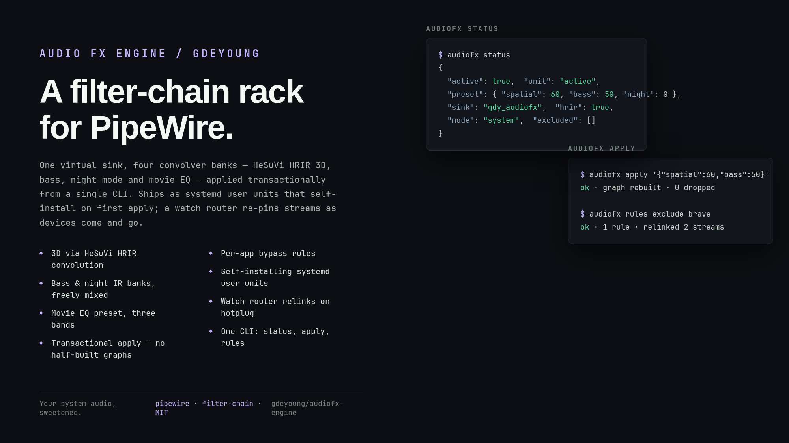

# audiofx — system-wide audio effects for PipeWire



A Boom 3D-style effects engine built natively on PipeWire: one virtual sink
(`gdy_audiofx`) that every app plays into, processed by a filter-chain and
passed through to your real output. No root, no driver changes, no daemon
config. Pairs with the [Audio FX Omarchy panel](https://github.com/gdeyoung/omarchy-audiofx),
which drives it from the desktop's audio dropdown — but it works from any
terminal or window manager.

## Effects

- **Off** — no processing, zero overhead, audio path untouched
- **3D** — binaural virtual surround for headphones (HeSuVi 14-channel HRIR
  convolver bank after the stock PipeWire virtual-surround pattern; games can
  feed it real 7.1, stereo gets upmixed)
- **Bass** — low-shelf boost baked into a convolution IR, regenerated per
  strength
- **Night** — spectral night mode: pulls down lows/highs, lifts dialogue
  presence, for late-hour listening
- **Movie** — 3D 40% + bass 45% + night 35% composed in one graph
- **Loud** — orthogonal to the presets (own chip, 0–100 → 0…+6 dB): a fixed
  120 Hz high-pass IR pair feeding one stereo SWH `fastLookaheadLimiter`
  (`swh-plugins`, LADSPA) whose input gain carries the loudness and whose
  limit pins the ceiling at −1 dBFS. Why this shape: the MAX98390 amps'
  excursion limiter normalizes plain software gain away (measured four ways,
  2026-10-18 — a +6 dB pre-gain returned −0.6 dB), but high-passing the
  sub-120 Hz energy the drivers cannot reproduce frees the amps' budget, and
  gain into a lookahead limiter then lands — the same construction as the
  upstream GalaxyBook EasyEffects "Loud" presets. Ear-validated on the
  Book5 Pro 16": +6 dB is clearly audible, no audible distortion.

Effects compose — the graph is `[ 3D bank ] -> [ bass IR ] -> [ night IR ] ->
[ Loud stage ]` with bypassed stages absent — and amounts are continuous
(0–100), so any mix is valid. Loud is inherited across preset switches: an
`apply` payload without a `loud` key keeps the current loud amount; explicit
`"loud": 0` disables it; all four at zero turns the engine off. Preset
switches restart only the engine's own PipeWire client,
never the daemon, so Spotify, browsers and Steam never drop their
connection. Apply is transactional: config render → unit restart →
sink-present check, with rollback to the previous default sink on failure.

**Routing rules:** effects can cover everything, or everything except a list
of apps (games go direct). A watcher (`audiofx-watch.service`) keeps streams
on the right sink as apps come and go.

## Mute & volume authority

An FX chain creates two sinks where a plain setup has one, and mute state
that lands on the wrong one is silent and invisible — the classic
"it's muted somewhere and unmuted everywhere I can see" wedges. This engine
enforces one model:

- **The virtual sink (`gdy_audiofx`) is plumbing, not a control.** The
  watcher's *guardian* pins it unmuted at 100% and reverts any flip within
  about a second — whether it came from a UI bug, a stale node handle, or an
  app that likes to mute things. Every repair is logged:
  `journalctl --user -u audiofx-watch | grep guardian`.
- **The physical output device is the only mute/volume control.** Speaker
  icon, volume keys, pavucontrol — all of them speak for the real device,
  and none of them can get shadowed by the chain.
- **The mic is the mic.** Input mute lives on the default source, full stop.

The [Audio FX panel](https://github.com/gdeyoung/omarchy-audiofx) writes
mutes to both ends of the chain so its switches always match what you hear;
the guardian makes the virtual end a no-op even if something else touches it.

## Install

```sh
git clone https://github.com/gdeyoung/audiofx-engine ~/omarchy-audiofx
mkdir -p ~/.local/bin
cp ~/omarchy-audiofx/audiofx.py ~/omarchy-audiofx/irgen.py ~/.local/bin/
chmod +x ~/.local/bin/audiofx.py
# swh-plugins supplies the Loud stage's limiter (LADSPA):
sudo pacman -S --needed swh-plugins
audiofx apply '{"spatial":60,"bass":50,"night":0,"loud":100}'
```

The first `apply` writes and enables the two systemd user units
(`audiofx.service`, `audiofx-watch.service`) and switches the default sink to
the FX sink. `audiofx off` removes the sink and restores the previous
default.

Requires `pipewire` 1.0+, `wireplumber`, `python-numpy`. First 3D use
downloads a 280 KB HRIR from the Arctis-Sound-Manager repo (HeSuVi atmos)
into `~/.local/share/audiofx/hrir/`; no other network access.

## CLI

```
audiofx status                                # JSON: active, preset, target, mode, excluded
audiofx doctor                                # audit the whole tree; exit 1 on wedges
audiofx presets                               # the built-in presets
audiofx apply '{"spatial":60,"bass":50,"night":0}'
audiofx rules system                          # effects on everything
audiofx rules apps '["Steam"]'                # everything except the listed apps
audiofx watch                                 # runs in the unit; keeps streams routed
audiofx off                                   # stop, remove sink, restore default
```

State lives in `~/.local/share/audiofx/` (state.json, generated IRs, HRIR);
configs render to `~/.config/pipewire/audiofx.conf*`. Remove everything:
`audiofx off`, delete the clone, `rm -rf ~/.local/share/audiofx
~/.config/pipewire/audiofx.conf*`.

## Troubleshooting

Run `audiofx doctor` first — it prints the whole tree (default sink and
source, both sinks' mute/volume, routing mode) and exits non-zero on the
known wedge states:

```console
$ audiofx doctor
{"engine": "active", "mode": "system", "defaultSink": "gdy_audiofx",
 "defaultSource": "alsa_input...Mic1__source", "target": "alsa_output...Speaker__sink",
 "virtualVolume": 1.0, "targetMuted": false, "targetVolume": 0.4,
 "sourceMuted": false, "faults": [], "warnings": [], "ok": true}
```

The faults it names, and their fixes:

| Fault | Meaning | Fix |
| --- | --- | --- |
| virtual sink is MUTED / volume ≠ 100% | plumbing was tampered with | should self-heal in ~1s; if not, `systemctl --user restart audiofx-watch` |
| streams playing into MUTED target | audio is playing but the speakers are muted — audible to nobody | unmute the output (panel switch or volume keys) |
| default source is MUTED | mic input dead: dictation and calls get silence | unmute the input (panel INPUT switch) |

Guardian repairs are visible as they happen:

```console
$ journalctl --user -u audiofx-watch | grep guardian
Oct 17 11:24:23 sammypro5 python3[788922]: [guardian] unmuted gdy_audiofx
```

## Files

- `audiofx.py` — engine: graph builder, config renderer, unit host, apply/
  status/rules/off transaction logic, mute-authority guardian, `doctor` audit
- `irgen.py` — numpy IR generator for bass/night (48 kHz stereo float WAVs)

## License

MIT — see [LICENSE](LICENSE). HeSuVi HRIR fetched at runtime from the
GPL-3.0 Arctis-Sound-Manager bundle; not redistributed here.
